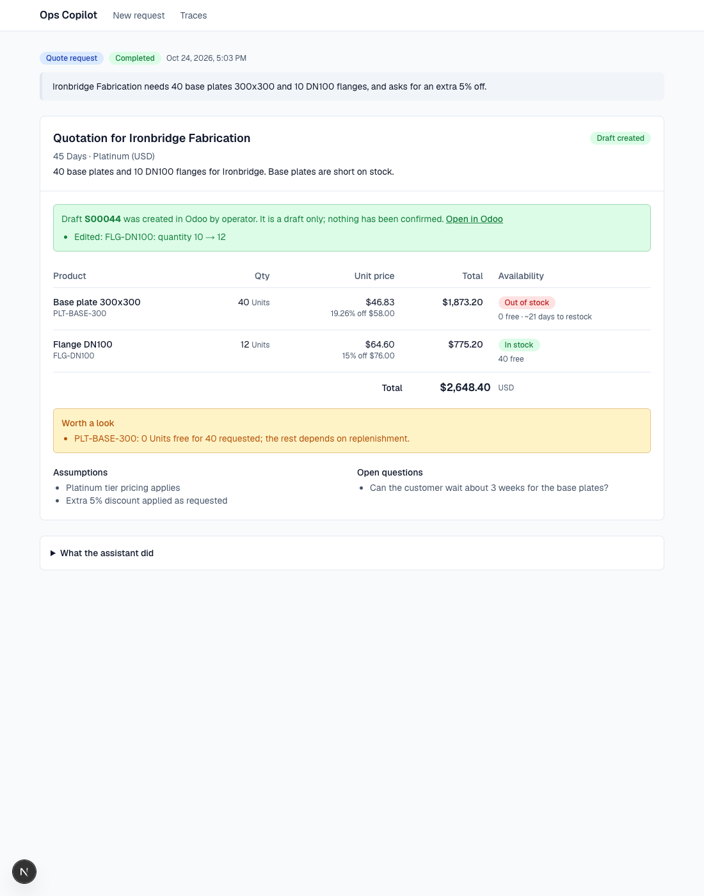
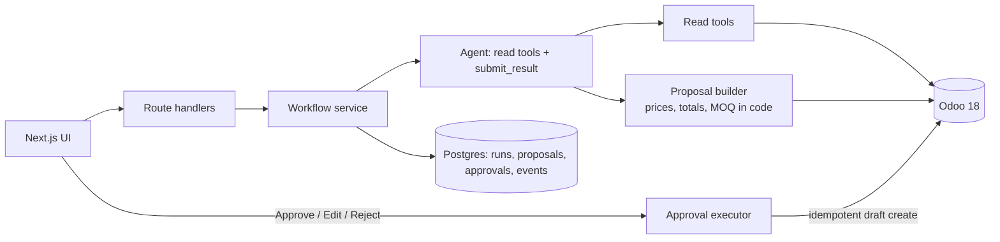
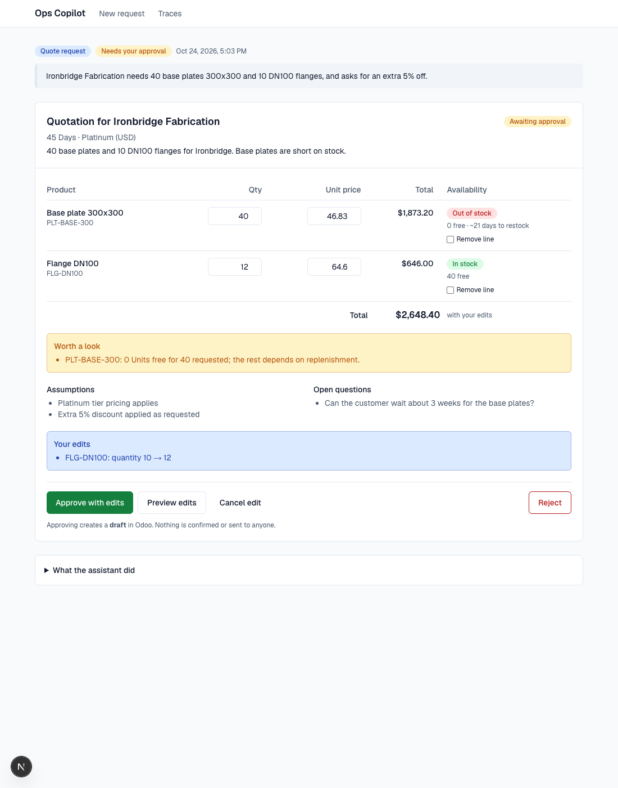

# Manufacturing Ops Copilot

AI agents that **quote** and **procure** against a real ERP (Odoo Community), where a human approves
everything and the system only ever creates **drafts**.

A customer request becomes a priced draft quotation; a stock shortage becomes a draft purchase order.
The agent reads Odoo through typed tools and proposes. Code computes every number. A person reviews,
optionally edits, and approves; only then does an idempotent writer create the draft in Odoo.



_Screenshots use runs from the scripted demo model (see [Web UI](#web-ui)), not LLM output._

## Status

| Area                                                              | State                                             |
| ----------------------------------------------------------------- | ------------------------------------------------- |
| Odoo 18 Community + reproducible seed data                        | Done                                              |
| Typed Odoo client, read tools, pricing engine                     | Done                                              |
| Quoting and procurement agents (Vercel AI SDK, provider-agnostic) | Done, tested with a scripted model                |
| Workflow state machine, approval executor, Postgres persistence   | Done                                              |
| Web UI (request, live run, proposal card, traces)                 | Done                                              |
| **Real-model runs**                                               | **Not run yet** (no provider keys were available) |
| Evals and model comparison, token/cost tracking, guardrail limits | **Deferred by choice**                            |

Nothing in this repository claims measured accuracy or cost. There is no eval table because no evals
have been run.

## How it works



Run states: `RECEIVED → GATHERING → PROPOSING → AWAITING_APPROVAL → APPROVED → WRITING → COMPLETED`,
plus `REJECTED`, `NEEDS_CLARIFICATION`, `CANNOT_FULFILL`, `FAILED`
([diagram](docs/architecture.md)).

## Design decisions

- **Drafts only, human approval required.** The model has read tools plus `submit_result`. The write
  layer is imported only by the approval executor, and a test fails if agent code reaches it.
- **The model chooses, code computes.** It submits ids and quantities. Unit prices (pricelist tiers and
  volume breaks), totals, MOQs, lead times and availability come from Odoo data, so a model cannot
  invent a price.
- **One agent with good tools**, not a multi-agent system. Two workflows, each with a short toolset.
- **Idempotent approval.** One decision per proposal (unique index), an atomic `pending → writing`
  claim, and an idempotency key stored on the Odoo record and looked up before every create. Double
  clicks and retries create one record.
- **Stale data is caught.** Approval rebuilds the proposal from current Odoo state; if prices or stock
  moved, nothing is written and the person re-approves the new numbers.
- **Failures are contained.** A failed write returns to the approval step and says nothing was
  confirmed; a failed run says nothing was created.
- Rationale for smaller choices is in [docs/decisions.md](docs/decisions.md).

## Quick start

Requires Node 22+, pnpm, Docker.

```bash
pnpm install
cp .env.example .env                               # set AGENT_MODEL and a provider key for real runs
docker compose up -d odoo-db app-db
docker compose --profile init run --rm odoo-init   # one-time Odoo database setup
docker compose up -d odoo
pnpm seed                                          # fictional manufacturer
pnpm db:migrate                                    # app database tables
pnpm dev                                           # http://localhost:3000
```

Odoo is at http://localhost:8069 (`admin` / `admin`). `pnpm reset` restores the exact seeded baseline.
Setup details and API key creation: [docs/odoo-setup.md](docs/odoo-setup.md).

## Web UI

- **/** request box (Quote request or Check shortages) and recent runs
- **/runs/[id]** live progress, then the proposal card with Approve / Edit / Reject; after approval,
  a link to the draft in Odoo
- **/traces** every run with status, model and duration; drill into the event timeline

New runs need `AGENT_MODEL` (`<provider>:<model-id>`, e.g. `anthropic:<id>`) and the matching key
(`ANTHROPIC_API_KEY`, `OPENAI_API_KEY` or `GOOGLE_GENERATIVE_AI_API_KEY`). To explore without a key,
`pnpm demo:runs` creates runs from a scripted stand-in model (id `demo:scripted`): real tools, pricing,
Odoo data and approval flow, but no LLM. Walkthrough: [docs/demo-script.md](docs/demo-script.md).

CLI: `pnpm agent:quote "..."`, `pnpm agent:procure "check shortages"`.



## Tech stack and pinned versions

| Component        | Version                                                                  |
| ---------------- | ------------------------------------------------------------------------ |
| Odoo             | Community 18.0 (`odoo:18.0-20261015`), JSON-RPC `/jsonrpc`               |
| PostgreSQL       | 16.15 (`postgres:16.15-alpine`), separate instances for Odoo and the app |
| Next.js / React  | 16.4.3 / 19.3.0, App Router, Tailwind 4                                  |
| AI SDK           | `ai` 7.x with `@ai-sdk/openai`, `@ai-sdk/anthropic`, `@ai-sdk/google`    |
| Validation / ORM | Zod 4.x, Drizzle ORM 0.45 with `pg` 8                                    |
| Tests            | Vitest 5, Testing Library                                                |

## Scripts

| Command                                   | What it does                                                    |
| ----------------------------------------- | --------------------------------------------------------------- |
| `pnpm dev` / `pnpm build`                 | Web app                                                         |
| `pnpm seed` / `pnpm reset`                | Idempotent seed / drop and rebuild Odoo then reseed             |
| `pnpm baseline:digest`                    | Hash of the seeded data to verify reproducibility               |
| `pnpm db:migrate`                         | Apply Drizzle migrations to the app database                    |
| `pnpm demo:runs`                          | Seed demo runs (scripted stand-in model)                        |
| `pnpm agent:quote` / `pnpm agent:procure` | Run an agent from the terminal                                  |
| `pnpm test`                               | Unit and component tests (no services needed)                   |
| `pnpm test:integration`                   | Tests against live Odoo and Postgres (needs the stack and seed) |
| `pnpm lint` / `pnpm typecheck`            | Static checks                                                   |

## Testing

`pnpm test` runs 87 unit and component tests. `pnpm test:integration` runs 48 tests against live Odoo
and Postgres with a scripted model, covering the read tools, proposal builders, double and concurrent
approval, stale prices, edits, a flaky Odoo write, and the API handlers. CI (`.github/workflows/ci.yml`)
runs lint, typecheck, unit tests and build; it has not been run on GitHub yet.

## Limitations and what is next

- **No real-model run yet.** Prompts and tool descriptions are untested against an actual LLM.
- **No evals.** The plan's eval suite (60-100 cases, model comparison) is the next big piece.
- **No guardrail limits.** Max discount, order value, quantity and price-sanity checks are drafted in
  `src/lib/guardrails` but not wired in. Today's validation covers existence, positive quantities, MOQ,
  duplicate lines and "already covered by an open PO".
- **No token or cost accounting**, retries/fallback models, or per-run budgets. `src/lib/observability`
  is an unused draft.
- Runs execute in the web server process; a serverless deploy would need a queue.
- Pricing supports percentage and fixed pricelist rules (what the seed uses); formula and category
  rules fail loudly rather than being guessed.
- No authentication or multi-tenancy (out of scope by plan).

## Docs

- [Architecture and state machine](docs/architecture.md)
- [Odoo setup and API key](docs/odoo-setup.md)
- [Seed data and shortage scenarios](docs/seed-data.md)
- [Decisions](docs/decisions.md)
- [Demo script](docs/demo-script.md)
