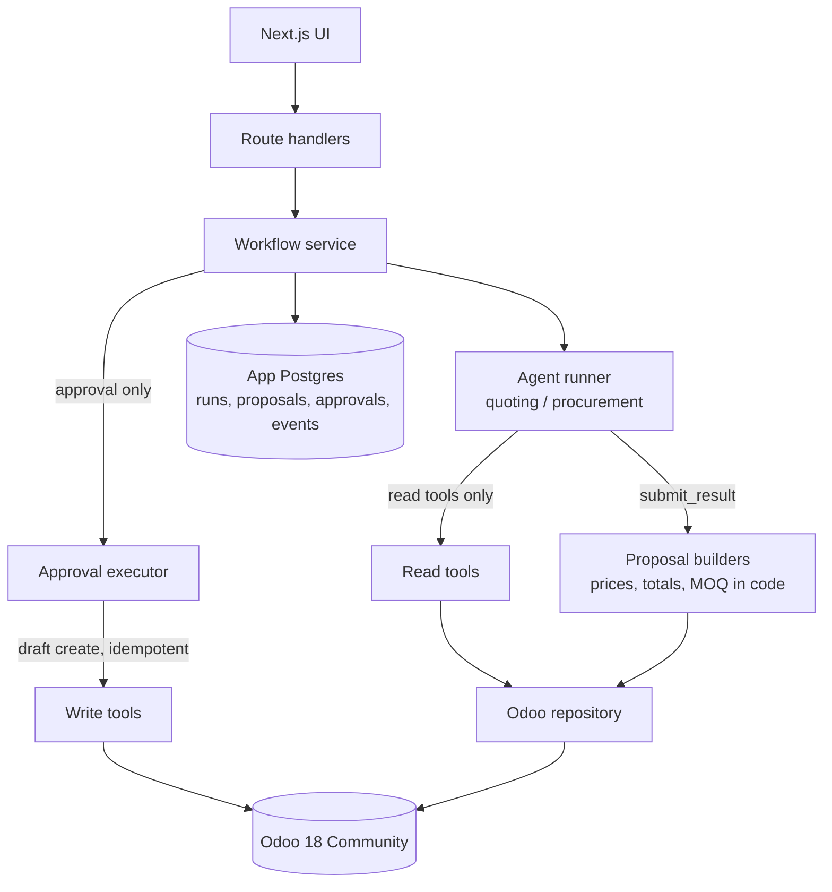
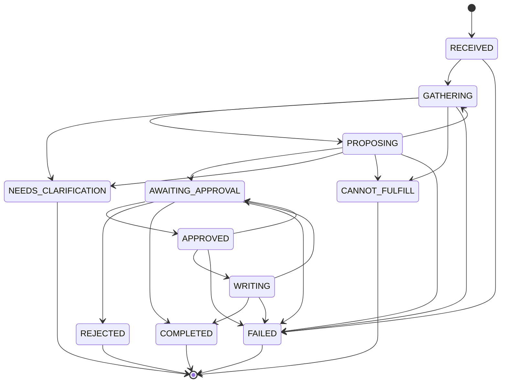

# Architecture

## Safety properties

- **Agents cannot write.** The model's tools are the read tools plus `submit_result`. The write
  layer (`src/lib/tools/write`) is imported only by the workflow service; `boundary.test.ts`
  fails if agent code imports it or exposes a mutating tool.
- **The model never supplies a number.** It submits ids and quantities. Builders compute unit
  prices (pricelist tiers, volume breaks), totals, MOQs, lead times and availability from Odoo.
- **Drafts only.** Writers create `sale.order` / `purchase.order` in state `draft`; nothing
  confirms them.
- **One approval, one record.** `approvals.proposal_id` is unique, the proposal is claimed with an
  atomic `pending -> writing` update, and the Odoo record carries an idempotency key
  (`client_order_ref` / `partner_ref`) that is looked up before every create.
- **Stale data is caught.** Approval rebuilds the proposal from current Odoo state. If prices or
  availability moved, nothing is written; the human sees the new numbers and approves again.
- **Edits are re-validated** and stored as a diff next to the untouched original agent output.

## Run state machine

Generated from `src/lib/workflow/state.ts`.

`CANNOT_FULFILL` is added to the plan's states so a refusal is distinguishable from a failure.
A failed write returns the run to `AWAITING_APPROVAL`; retrying is safe because of the idempotency key.

## Data model

| Table        | Purpose                                                                                       |
| ------------ | --------------------------------------------------------------------------------------------- |
| `runs`       | One request: kind, model, state, clarification/refusal outcome, failure reason                |
| `proposals`  | Current proposal JSON plus the original agent output; pending / writing / approved / rejected |
| `approvals`  | The single decision per proposal: actor, edit diff, idempotency key, Odoo record              |
| `run_events` | Ordered timeline (status changes, tool calls, submissions, write outcomes)                    |

## Not built yet

Evals, step-level token/cost accounting, guardrail limits (max discount, order value, price sanity),
fallback models and per-run cost caps. `src/lib/guardrails` and `src/lib/observability` contain
early drafts that are not wired in.
